<div align="center">

<a href="https://github.com/GiGomieri05">
  
</a>

<p>
  <a href="https://github.com/GiGomieri05"></a>
  <a href="https://facens.br"></a>
  <a href="https://rdbfutura.com.br"></a>
  <a href="https://linkedin.com/in/giovannigomieri"></a>
</p>

`ENGINEERING` · `SOFTWARE` · `ROCKETRY` · `EDTECH` · `ROBOTICS` · `ASTRONOMY`

</div>


## `> boot.sequence`



I work where **software meets the physical world**: digital products, embedded systems, educational technology, robotics and practical science experiences. I'm most interested in problems that cross layers of engineering, instead of treating software, hardware and product as isolated worlds.


## `> mission.control`



<details>
<summary><b>🚀 flight log</b> <sub>(click to expand)</sub></summary>
<br />

```text
MOBFOG / JORNADA BRASILEIRA DE FOGUETES
├── national record ........... 488.5 m
├── 46ª Jornada Brasileira de Foguetes
├── Copa Paulista ............. champion
├── AMERIFOG .................. 2× champion
└── awards .................... 26 and counting
```

</details>


## `> rdb.futura --orbit`



**[RDB Futura](https://rdbfutura.com.br)** is my EdTech initiative: hands-on STEAM missions, a gamified learning platform and physical kits that turn theory into evidence of practical learning, using astronomy as the gateway to science and engineering.


## `> tech.stack --organized`

<table>
<tr>
<td width="50%" valign="top">

### `01 // CODE`

<p align="center">
  &nbsp;&nbsp;
  &nbsp;&nbsp;
  &nbsp;&nbsp;
  &nbsp;&nbsp;
  &nbsp;&nbsp;
  
</p>

<p align="center">
  &nbsp;&nbsp;
  
</p>

`C++` `C` `Python` `JavaScript` `TypeScript` `Java` `HTML` `CSS`

</td>
<td width="50%" valign="top">

### `02 // BUILD`

<p align="center">
  &nbsp;&nbsp;
  &nbsp;&nbsp;
  &nbsp;&nbsp;
  
</p>

`React` `Next.js` `Django` `Flutter`

<br />

**Focus:** web platforms, educational products and cross-platform experiences.

</td>
</tr>
<tr>
<td width="50%" valign="top">

### `03 // CLOUD & DATA`

<p align="center">
  &nbsp;&nbsp;
  &nbsp;&nbsp;
  &nbsp;&nbsp;
  
</p>

<p align="center">
  &nbsp;&nbsp;
  &nbsp;&nbsp;
  
</p>

`Supabase` `Firebase` `AWS` `Google Cloud` `SQL Server` `Cloudflare` `Vercel`

</td>
<td width="50%" valign="top">

### `04 // SYSTEMS & HARDWARE`

<p align="center">
  &nbsp;&nbsp;
  &nbsp;&nbsp;
  
</p>

`Git` `Linux` `Arduino` `Embedded Systems` `IoT`

<br />

**Interest:** systems that connect code, sensors, hardware and the real world.

</td>
</tr>
</table>


## `> github.telemetry`

<div align="center">
  
  
</div>

<p align="center">
  <sub>Telemetry is generated by GitHub Actions and stored inside this repository.</sub>
</p>

## `> operating.mode`

```text
[ BUILD  ]  software products + educational technology
[ LEARN  ]  algorithms + competitive programming + systems
[ TEST   ]  prototypes + hardware + hands-on experiences
[ SHIP   ]  real products for real users
[ LAUNCH ]  sometimes literally 🚀
```


## `> uplink --contact`

<div align="center">

[](https://linkedin.com/in/giovannigomieri)
[](mailto:giovanni@rdbfutura.com.br)
[](https://rdbfutura.com.br)

<br /><br />



<br />


<sub>animations are hand-made SVG, generated by <a href="scripts/build_profile_svgs.py"><code>scripts/build_profile_svgs.py</code></a></sub>

</div>
